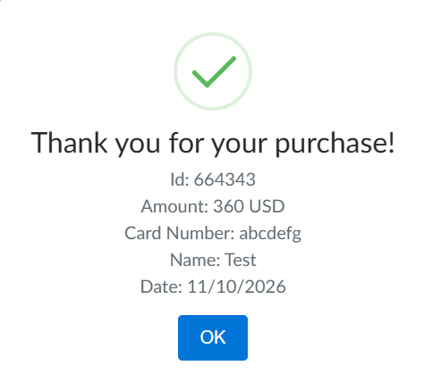

# BUG-001: Checkout form accepts alphabetic characters in the Credit Card field

**Status:** Open
**Severity:** Major
**Priority:** High
**Environment:** 
- OS: Windows 11
- Browser: Google Chrome (Latest stable)
- URL: https://www.demoblaze.com/

## Preconditions
- The user has at least one item added to the shopping cart.
- The user is on the "Place Order" form.

## Steps to Reproduce
1. Open the Cart page and click the "Place Order" button.
2. Fill in the "Name", "Country", and "City" fields with valid data.
3. Enter alphabetic characters in the "Credit card" field (e.g., "abcd").
4. Fill in the "Month" and "Year" fields with valid numbers.
5. Click the "Purchase" button.

## Expected Result
The system should prevent the order from being placed and display a validation error (e.g., "Please enter a valid credit card number"), as credit card numbers cannot contain letters.

## Actual Result
The order is successfully placed. The "Thank you for your purchase!" confirmation appears, and the order is processed with invalid payment data.

## Attachments

